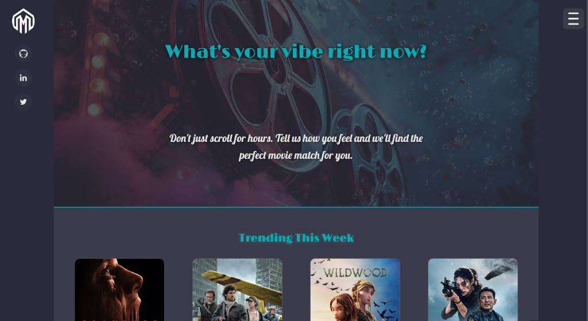
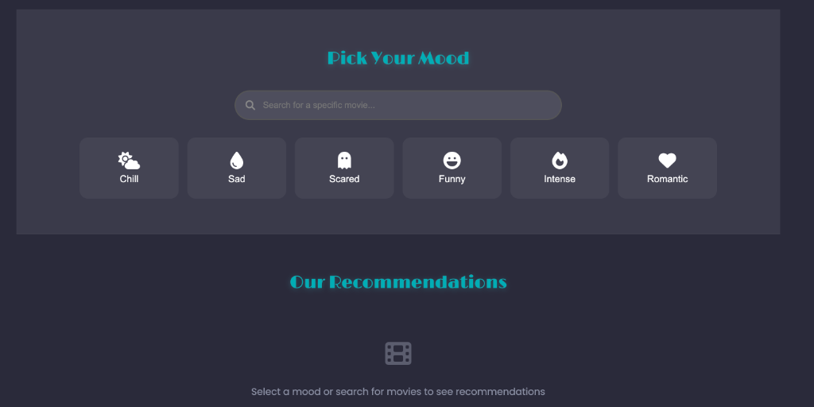
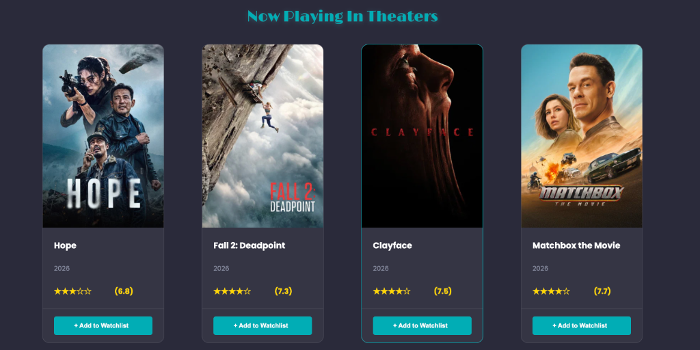
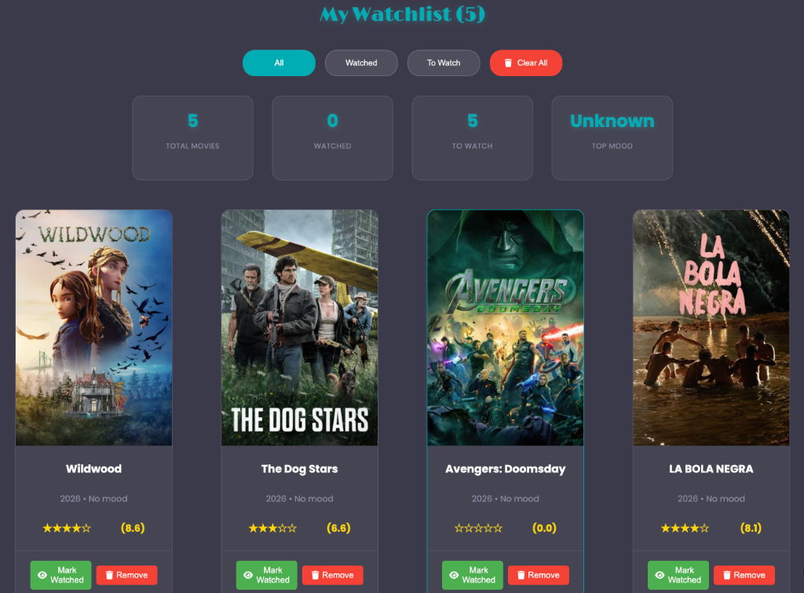
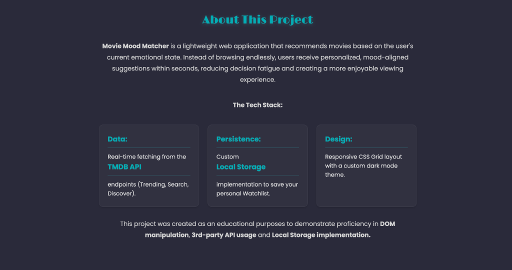

<div align="center">

# 🎬 MovieMoodMatcher
### Mood-Based Movie Discovery Engine & Secure TMDB Serverless Gateway

[](https://matchmoviemood.netlify.app/)
[](https://developer.mozilla.org/en-US/docs/Web/JavaScript)
[](https://www.netlify.com/products/functions/)
[](https://www.themoviedb.org/)
[](https://developer.mozilla.org/en-US/docs/Web/CSS)
[](LICENSE)

<br/>

**An asynchronous cinema discovery web application that translates psychological mood states into targeted movie recommendations, featuring an enterprise-grade serverless API proxy, debounced real-time search, and local storage watchlist analytics.**

<br/>

[](https://matchmoviemood.netlify.app/)

<br/>

[🚀 **Explore Live Application**](https://matchmoviemood.netlify.app/) · [Report Bug](https://github.com/snaimio/movie-mood-matcher/issues) · [Request Feature](https://github.com/snaimio/movie-mood-matcher/issues)

</div>

<br/>

---

## 📌 Overview

Instead of endlessly scrolling through streaming catalogues, **MovieMoodMatcher** helps viewers overcome decision fatigue by mapping emotional states directly to cinematic genres. Users select their vibe—such as *Chill*, *Sad*, *Scared*, *Funny*, *Intense*, or *Romantic*—and the platform asynchronously queries curated cinema titles with real-time ratings, release dates, and trailer playback.

---

## 📸 Application Showcase

### 1. Mood-Based Discovery Engine
Select an emotional state or enter search keywords. The application dynamically compiles multi-genre queries and renders matching cinema cards without page reloads.



---

### 2. Live Cinema & Weekly Trends
Fetches real-time releases currently in theaters and weekly trending movies from The Movie Database with responsive card layouts and star ratings.



---

### 3. Personal Watchlist & Analytics
Full client-side persistence using `localStorage`. Users can track total movies, mark items as watched/unwatched, remove titles, and view automated top-mood distribution metrics.



---

### 4. Technical Architecture & Dark Mode UI
Engineered with modular object-oriented JavaScript, CSS Grid viewports, and custom dark-mode aesthetics designed for seamless mobile and desktop browsing.



---

## 🔒 Enterprise Security Architecture

To adhere to industry-standard credential security, this repository implements a **Serverless Gateway Pattern** via Netlify Functions:

```
[Browser Client] 
       │ 
       ▼ GET /api/tmdb?endpoint=... (No API Key Exposed)
[Netlify Serverless Function] (tmdb.js)
       │ 
       ├─► Securely injects process.env.TMDB_API_KEY from Encrypted Vault
       ▼ 
[TMDB REST API v3] (https://api.themoviedb.org/3/...)
```

- **Zero Client-Side Secret Leakage**: The TMDB API key is never bundled in frontend JavaScript, never exposed in HTML source, and never transmitted in browser Network requests.
- **Serverless Reverse Proxy**: All TMDB endpoints route through `/.netlify/functions/tmdb` via `netlify.toml` URL rewrites.
- **Header Caching & Rate Protection**: Requests are cached on Netlify's edge CDN for 5 minutes (`Cache-Control: public, max-age=300`) to optimize response latency and mitigate upstream rate limits.
- **Strict Method & Parameter Validation**: Only sanitized `GET` queries with verified parameters are passed upstream.

---

## 🛠️ Stack & Architecture

- **Frontend**: Vanilla JavaScript (ES6+ Class Architecture), Semantic HTML5, Modern CSS3 (Custom Properties, Grid, Flexbox, Skeleton Loaders).
- **Backend / Proxy**: Netlify Serverless Functions (Node.js runtime), URL Redirect Rewrites.
- **Data Source**: The Movie Database (TMDB) RESTful API v3.
- **Persistence**: Browser `localStorage` with automated JSON serialization/deserialization.
- **Icons & Media**: FontAwesome 6, TMDB CDN (`image.tmdb.org`).

---

## 🚀 Local Development Setup

### Prerequisites
- Node.js (v18+)
- [Netlify CLI](https://docs.netlify.com/cli/get-started/) (`npm install -g netlify-cli`)

### Quickstart
1. **Clone the repository:**
   ```bash
   git clone https://github.com/snaimio/movie-mood-matcher.git
   cd movie-mood-matcher
   ```

2. **Configure Environment Variables:**
   ```bash
   cp .env.example .env
   ```
   Add your TMDB API key from [themoviedb.org/settings/api](https://www.themoviedb.org/settings/api):
   ```env
   TMDB_API_KEY=your_actual_tmdb_api_key
   ```

3. **Start Local Development Server with Functions:**
   ```bash
   netlify dev
   ```
   Open `http://localhost:8888` in your browser. Netlify Dev runs your serverless function locally and injects your `.env` variables automatically.

---

## 📄 License
This project is open-source under the [MIT License](LICENSE).

---

## 👨‍💻 Author
**Sheikh Naim**  
*Mobile & Full-Stack Web Developer*  
- **LinkedIn**: [linkedin.com/in/snaimio](https://www.linkedin.com/in/snaimio)  
- **GitHub**: [@snaimio](https://github.com/snaimio)  
- **Portfolio**: [snaimio.github.io](https://snaimio.github.io)
